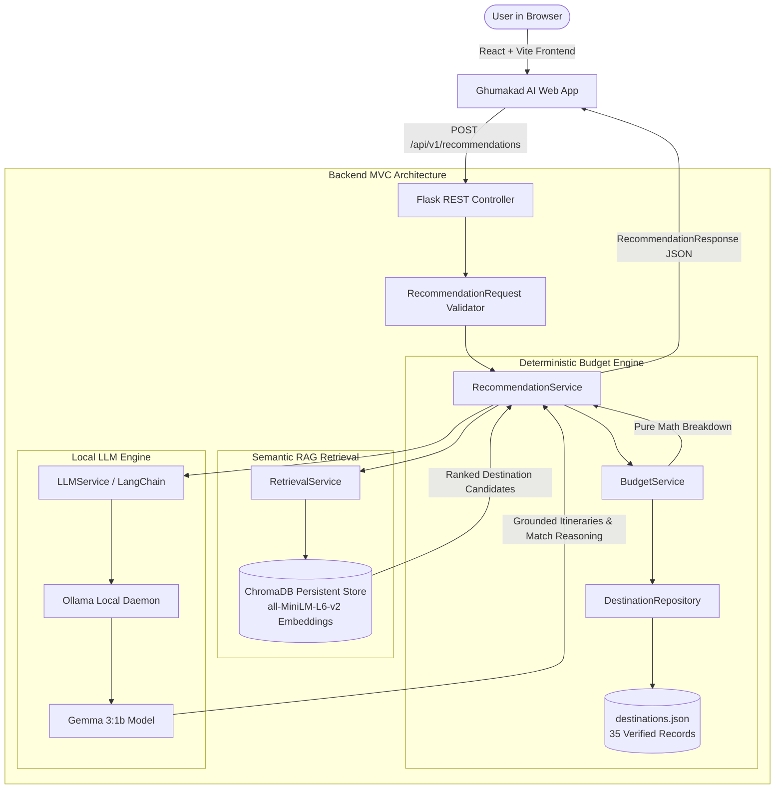

# Ghumakad AI 🧭
> *"Your Budget. Your Vibe. Your Next Adventure."*

An AI-powered travel recommendation and grounded itinerary planning application focused on curated Indian destinations. Built for hackathons, travelers, and open-source contributors.

---

## 🌟 Overview & Problem Statement

Travel planning today is fraught with two major challenges:
1. **Hallucinated or Unrealistic Pricing**: Generic AI chatbots frequently invent hotel prices, flight costs, and itineraries disconnected from real budgets.
2. **Generic Recommendations**: Traditional aggregators push commercial packages rather than tailoring journeys to user vibes (e.g., quiet beaches vs. cliffside spirituality vs. high-altitude adventures).

**Ghumakad AI** solves this by decoupling financial calculations from language model generation:
- **Deterministic Budget Engine**: Calculates exact room requirements (`ceil(travellers / 2)`), daily food, local transit, activities, and intercity baselines in pure Python math without delegating math to the LLM.
- **ChromaDB Vector Retrieval**: Embeds and matches destinations based on semantic vibe and preferences.
- **Local Gemma 3:1b via Ollama**: Synthesizes grounded, day-by-day itineraries strictly using verified attractions and local tips without leaking hallucinations.

---

## 🏛️ System Architecture



---

## 🚀 Key Features

- **Strict Budget Enforcement**: Separates affordable options from over-budget ones. Flags incomplete data rather than assuming missing costs are free.
- **Shared Room Economics**: Intelligently models group lodging (e.g. 3 travelers require 2 double-occupancy rooms).
- **Private & Local AI**: Runs entirely on your local machine using Ollama and Gemma 3:1b. No commercial API keys or data transmission to third parties.
- **Grounded Day-by-Day Itineraries**: Generates distinct daily schedules referencing verified local landmarks, morning highlights, afternoon culture, and sunset spots.
- **Graceful Deterministic Fallback**: If Ollama or the local model is offline or warming up, the system automatically uses verified dataset facts and clearly indicates the fallback status.
- **Verified Indian Dataset**: 35 curated destinations across 18 states covering beaches, mountains, heritage, spirituality, wildlife, food & culture, and offbeat locales.
- **Travel-Inspired UI**: Responsive React interface featuring dark glassmorphism, dynamic budget presets, stepper controls, and collapsible breakdown drawers.

---

## 🛠️ Technology Stack

| Layer | Technologies |
| :--- | :--- |
| **Frontend** | React 19, Vite, JavaScript (ES6+), Vanilla CSS (Design System) |
| **Backend** | Python 3.13, Flask 3.1, Flask-CORS, Pydantic 2.14 |
| **AI / LLM** | Ollama, Gemma 3:1b, LangChain, LangChain-Ollama |
| **Vector DB** | ChromaDB 1.5, ONNX Runtime (`all-MiniLM-L6-v2` embeddings) |
| **Testing** | Pytest 9.2, Mock |

---

## 📂 Project Structure

```
HACKTOBER/
├── frontend/                     # React + Vite application (JavaScript only)
│   ├── public/
│   ├── src/
│   │   ├── components/           # Reusable UI components
│   │   │   ├── Navbar.jsx
│   │   │   ├── Hero.jsx
│   │   │   ├── TravelForm.jsx
│   │   │   ├── DestinationCard.jsx
│   │   │   ├── BudgetBreakdown.jsx
│   │   │   ├── DayWiseItinerary.jsx
│   │   │   ├── FeaturedDestinations.jsx
│   │   │   ├── HowItWorks.jsx
│   │   │   ├── LoadingIndicator.jsx
│   │   │   ├── ErrorMessage.jsx
│   │   │   ├── EmptyResultsState.jsx
│   │   │   └── Footer.jsx
│   │   ├── services/
│   │   │   └── api.js            # REST API client
│   │   ├── styles/
│   │   │   ├── index.css         # Design tokens & utilities
│   │   │   └── App.css           # Component stylesheets
│   │   ├── App.jsx
│   │   └── main.jsx
│   ├── package.json
│   ├── vite.config.js
│   └── .env.example
├── backend/                      # Python Flask MVC backend
│   ├── app/
│   │   ├── models/               # Pydantic schemas
│   │   │   ├── destination.py
│   │   │   ├── recommendation_request.py
│   │   │   └── recommendation_response.py
│   │   ├── controllers/          # Request handling
│   │   │   ├── health_controller.py
│   │   │   ├── destination_controller.py
│   │   │   └── recommendation_controller.py
│   │   ├── routes/               # API Blueprints
│   │   │   ├── health_routes.py
│   │   │   ├── destination_routes.py
│   │   │   └── recommendation_routes.py
│   │   ├── services/             # Core business & AI logic
│   │   │   ├── budget_service.py
│   │   │   ├── retrieval_service.py
│   │   │   ├── llm_service.py
│   │   │   └── recommendation_service.py
│   │   ├── repositories/         # Dataset access layer
│   │   │   └── destination_repository.py
│   │   ├── data/
│   │   │   └── destinations.json # 35 curated destinations
│   │   ├── config.py             # Environment configuration
│   │   └── __init__.py           # Flask app factory
│   ├── scripts/
│   │   └── build_vector_store.py # ChromaDB indexer
│   ├── tests/                    # Pytest test suite
│   ├── requirements.txt
│   ├── .env.example
│   └── run.py                    # Server startup script
├── docs/
│   └── dataset_spec.md           # Pricing formulas and units
├── .gitignore
├── LICENSE
├── CONTRIBUTING.md
├── CODE_OF_CONDUCT.md
└── README.md
```

---

## ⚡ Quickstart Guide

### Prerequisites
- **Python**: Version 3.11, 3.12, or 3.13
- **Node.js**: Version 18+ (tested on Node v24)
- **Ollama**: Installed and running locally ([ollama.com](https://ollama.com))

### 1. Set Up Ollama with Gemma 3:1b
Ensure Ollama is running and pull the Gemma 3:1b model:
```powershell
# Verify Ollama is running
ollama --version

# Pull the Gemma 3:1b model
ollama run gemma3:1b
```

### 2. Set Up and Run Backend
```powershell
# Navigate to backend
cd backend

# Create virtual environment (if not already created)
python -m venv venv

# Activate virtual environment (Windows PowerShell)
.\venv\Scripts\activate
# (macOS/Linux: source venv/bin/activate)

# Install dependencies
pip install -r requirements.txt

# Build ChromaDB vector store
python scripts/build_vector_store.py

# Run the Flask backend
python run.py
```
Backend will start on `http://127.0.0.1:5000`.

### 3. Set Up and Run Frontend
In a separate terminal window:
```powershell
# Navigate to frontend
cd frontend

# Install npm dependencies
npm install

# Start Vite development server
npm run dev
```
Open `http://localhost:5173` in your browser.

---

## 📡 API Endpoints Reference

All API routes are prefixed with `/api/v1`.

### `GET /api/v1/health`
Returns system availability and AI readiness.
```json
{
  "api_version": "v1",
  "service": "Ghumakad AI Backend",
  "status": "ready",
  "ai_ready": true,
  "components": {
    "api": { "status": "operational", "code": 200 },
    "ollama": { "status": "operational", "base_url": "http://localhost:11434" },
    "model": { "name": "gemma3:1b", "status": "loaded" },
    "vector_store": { "status": "initialized" }
  }
}
```

### `GET /api/v1/destinations`
Query parameters:
- `state`: Filter by state (e.g. `?state=Kerala`)
- `type`: Filter by vibe/category (e.g. `?type=beaches`)
- `search`: Keyword search across names, descriptions, and attractions (e.g. `?search=rafting`)

### `GET /api/v1/destinations/<destination_id>`
Fetches detailed record for a destination (e.g. `/api/v1/destinations/dest_001`).

### `POST /api/v1/recommendations`
Request payload:
```json
{
  "budget": 15000,
  "duration_days": 3,
  "preferences": ["mountains", "adventure"],
  "departure_location": "Bhopal, Madhya Pradesh",
  "travellers": 2,
  "travel_style": "budget"
}
```

Response includes:
- `budget_feasible`: Boolean indicating whether verified destinations match the budget.
- `recommendations`: Array of ranked destination cards, each with:
  - `total_estimated_cost`, `cost_per_person`, `budget_status`
  - `expense_breakdown`: Detailed breakdown for lodging, food, local transport, activities, and transit
  - `day_wise_itinerary`: Day-by-day morning, afternoon, evening plans with tips
  - `missing_data_warnings`: Completeness flags
- `suggestions_if_unfeasible`: Actionable budget advice when funds are insufficient.

---

## 🧪 Testing

Run unit and integration tests using Pytest:
```powershell
cd backend
.\venv\Scripts\pytest tests -v
```

Tests verify:
- Health endpoint status reporting
- Destination repository filtering and search
- Deterministic budget formulas (solo vs group shared rooms)
- Style multipliers (budget vs luxury)
- Incomplete/missing data warnings
- Over-budget advice generation
- Schema validation for invalid/negative values
- Fallback mechanics when Ollama is unavailable

---

## 📊 Dataset Sources & Limitations

- **Curated Coverage**: 35 handpicked destinations representing all major Indian geographical zones.
- **Unit Standards**:
  - Accommodation: INR per standard room per night (`ceil(travellers / 2)` rooms assumed).
  - Food: INR per person per day.
  - Local Transport: INR per person per day.
  - Activity / Entry: INR per person per day.
- **Sources**: State Tourism Departments (MP Tourism, Kerala Tourism, Uttarakhand Tourism, Rajasthan Tourism, etc.) and verified regional travel tariffs.
- **Limitations**:
  - Live flight surge pricing is not included; intercity transit represents realistic baseline train/bus transit.
  - Personal shopping and discretionary nightlife costs are excluded.

---

## 🗺️ Roadmap

- [x] Python Flask MVC architecture
- [x] Deterministic budget calculation engine with shared lodging logic
- [x] ChromaDB persistent vector indexing (`all-MiniLM-L6-v2`)
- [x] Local Gemma 3:1b RAG integration via Ollama
- [x] React + Vite JavaScript UI with glassmorphic design system
- [x] Complete automated test suite
- [ ] Multi-city circuit planning (e.g. Golden Triangle routes)
- [ ] Live IRCTC train API integration
- [ ] Export itineraries to PDF and calendar formats

---

## 🤝 Contributing

Contributions are welcome! Please read [CONTRIBUTING.md](CONTRIBUTING.md) and adhere to our [Code of Conduct](CODE_OF_CONDUCT.md).

---

## 📄 Licence

This project is licensed under the MIT License - see the [LICENSE](LICENSE) file for details.
